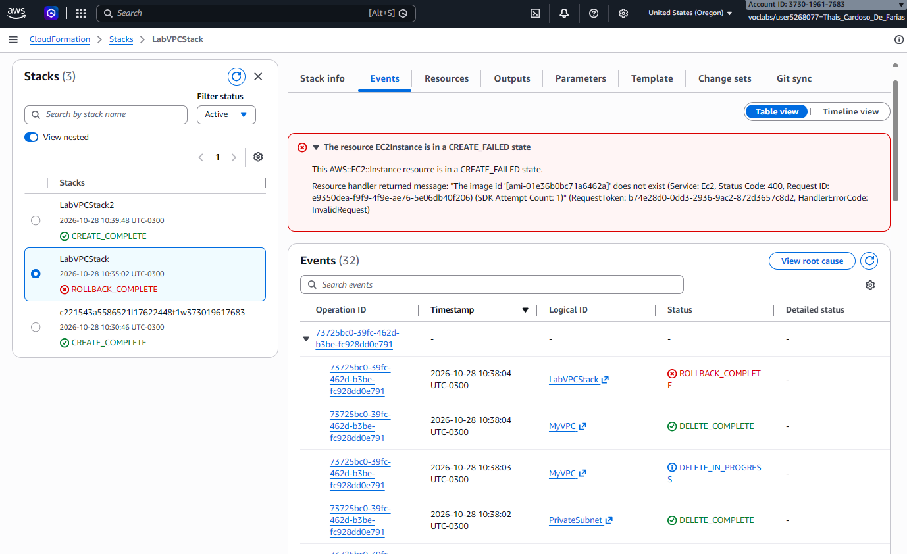
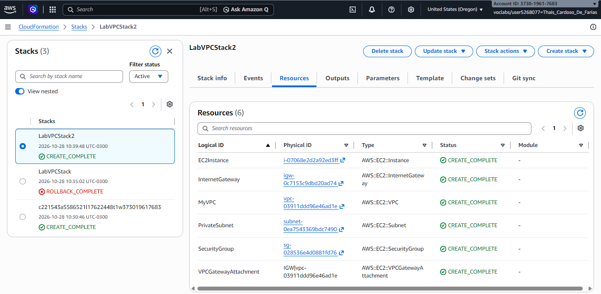
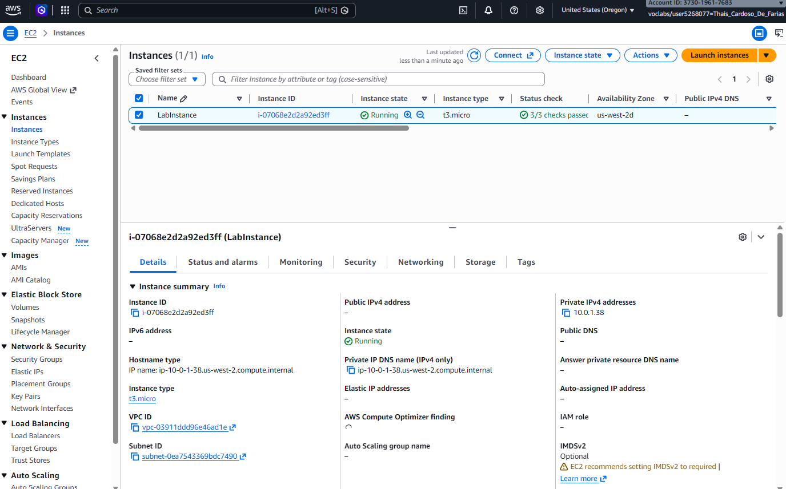
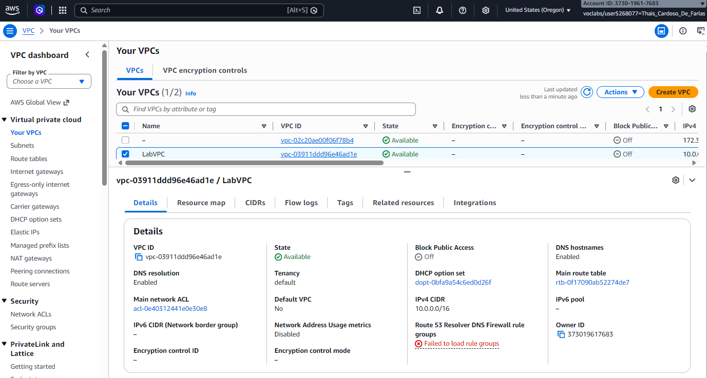

# 🚀 AWS CloudFormation Lab: VPC Segura e Instância EC2

Este repositório documenta a criação e o troubleshooting de uma infraestrutura automatizada na AWS utilizando **AWS CloudFormation** (Infraestrutura como Código - IaC), desenvolvido como parte dos estudos práticos do programa **AWS re/Start**.

---

## 🏗️ Arquitetura do Projeto

O objetivo deste laboratório foi provisionar um ambiente de rede isolado e seguro contendo os seguintes componentes:
1. **Amazon VPC (`AWS::EC2::VPC`):** Bloco CIDR `10.0.0.0/16` com suporte a DNS ativado.
2. **Internet Gateway (`AWS::EC2::InternetGateway`):** Conectado à VPC para gerenciar o tráfego externo.
3. **Sub-rede Privada (`AWS::EC2::Subnet`):** Bloco CIDR `10.0.1.0/24` para hospedar recursos com maior segurança.
4. **Grupo de Segurança (`AWS::EC2::SecurityGroup`):** Firewall configurado para permitir tráfego SSH (porta 22) de forma controlada.
5. **Instância EC2 (`AWS::EC2::Instance`):** Uma máquina virtual do tipo `t3.micro` provisionada dentro da sub-rede privada.

---

## 📄 O Código do Template (YAML)

O modelo utilizado para a criação bem-sucedida da infraestrutura:

```yaml
AWSTemplateFormatVersion: '2010-09-09'
Description: AWS re/Start Challenge Lab - VPC, IGW, Security Group, Subnet, and EC2 instance.

Resources:
  MyVPC:
    Type: AWS::EC2::VPC
    Properties:
      CidrBlock: 10.0.0.0/16
      EnableDnsHostnames: true
      EnableDnsSupport: true
      Tags:
        - Key: Name
          Value: LabVPC

  InternetGateway:
    Type: AWS::EC2::InternetGateway
    Properties:
      Tags:
        - Key: Name
          Value: LabIGW

  VPCGatewayAttachment:
    Type: AWS::EC2::VPCGatewayAttachment
    Properties:
      VpcId: !Ref MyVPC
      InternetGatewayId: !Ref InternetGateway

  PrivateSubnet:
    Type: AWS::EC2::Subnet
    Properties:
      VpcId: !Ref MyVPC
      CidrBlock: 10.0.1.0/24
      Tags:
        - Key: Name
          Value: LabPrivateSubnet

  SecurityGroup:
    Type: AWS::EC2::SecurityGroup
    Properties:
      GroupDescription: Allow SSH access from anywhere
      VpcId: !Ref MyVPC
      SecurityGroupIngress:
        - IpProtocol: tcp
          FromPort: 22
          ToPort: 22
          CidrIp: 0.0.0.0/0
      Tags:
        - Key: Name
          Value: LabSecurityGroup

  EC2Instance:
    Type: AWS::EC2::Instance
    Properties:
      InstanceType: t3.micro
      ImageId: '{{resolve:ssm:/aws/service/ami-amazon-linux-latest/amzn2-ami-hvm-x86_64-gp2:1}}'
      SubnetId: !Ref PrivateSubnet
      SecurityGroupIds:
        - !Ref SecurityGroup
      Tags:
        - Key: Name
          Value: LabInstance
```

## 🔍 Troubleshooting: Desafios Encontrados e Resolução

Durante as iterações iniciais de teste do template, a pilha falhou com o status `ROLLBACK_COMPLETE` devido a um erro de `CREATE_FAILED` no recurso `EC2Instance`.

### O Erro:
O modelo inicial utilizava um ID de AMI estático (`ami-01e36b0bc71a6462a`), que havia expirado ou não estava disponível na região `us-west-2` no momento da execução.



### A Solução:
Para evitar códigos de imagens estáticos que expiram rapidamente, a melhor prática adotada foi utilizar o **SSM Parameter Store**. Desta forma, o CloudFormation busca dinamicamente a AMI mais recente e compatível do Amazon Linux 2 no momento da criação:
```yaml
ImageId: '{{resolve:ssm:/aws/service/ami-amazon-linux-latest/amzn2-ami-hvm-x86_64-gp2:1}}'
```
## ✅ Resultado Final (Sucesso)

Após a correção no modelo, a pilha foi executada e finalizada com o status verde `CREATE_COMPLETE`, provisionando toda a infraestrutura com sucesso.

- **Stack Concluída no CloudFormation:**
  

- **Instância EC2 Rodando:**
  

- **VPC criada com sucesso:**
 
---

## 🔒 Segurança e Boas Práticas (Destruição de Recursos)

Em ambientes de nuvem e laboratórios acadêmicos (como o AWS Academy/Vocareum), a segurança e o controle de custos são prioridades absolutas:
* **Credenciais Temporárias:** Todas as credenciais de acesso utilizadas durante este laboratório foram geradas de forma dinâmica e efêmera.
* **Destruição de Recursos:** Ao término do laboratório, a sessão foi encerrada e o botão **End Lab** foi acionado, garantindo a revogação imediata das chaves de acesso e a **destruição completa de todos os recursos provisionados** (VPC, Instância EC2, Sub-rede e Gateways), evitando custos residuais ou exposição de dados.

---
*Desenvolvido com dedicação por Thais Cardoso de Farias durante os estudos em Cloud Computing.*

